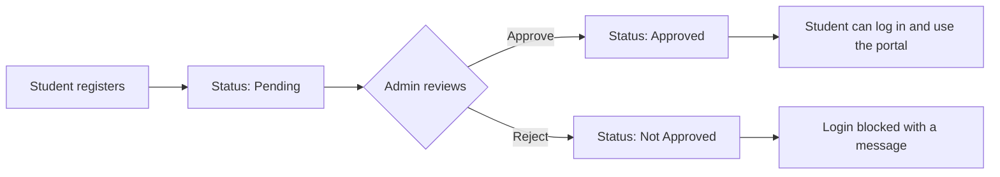

# Student Management Web Application

A lightweight web app for keeping student records, with an approval workflow and separate student and administrator portals. Built with plain PHP and MySQL, and it runs on XAMPP with no frameworks to install.

---

## The problem

Many schools and small organizations still manage student information with paper registers or loose spreadsheets. That causes the same problems again and again:

- **Records get lost or duplicated.** Paper gets damaged and files get copied, so nobody is sure which version is correct.
- **Finding a record is slow.** Searching by name, ID or department means scrolling through pages or files.
- **Updates are manual and error-prone.** Fixing one detail means editing it in several places.
- **No control over who sees what.** In a shared file, anyone can open or change anyone's record.
- **No approval step.** New students are added without anyone verifying them first.
- **Full student information systems are too heavy.** Large platforms need servers, setup, training and often a licence, which is more than a small organization needs.

## The solution

This app does the basics well and nothing more. All records live in one MySQL database, and access depends on the person's role.

| Task | Paper / spreadsheet | This application |
|---|---|---|
| Register a new student | Handwritten form | Online registration form with validation |
| Verify new students | Informal | Admin approves or rejects each registration before the student can log in |
| Find a record | Scroll or ask someone | Admin search by ID, name, email or department, plus a status filter |
| Update a record | Edit by hand | Admin edits any record; students edit only their own |
| Keep records private | Not possible | Students see only their own record |
| Remove a record | Cross out a line | Admin deletes after a confirmation prompt |

It is built for beginners, small organizations and academic assignments, and it also demonstrates core web development concepts: forms, sessions, role-based access and CRUD against a database.

### Trade-offs

This is a deliberately small system. It has no email sending, no audit log, no reports or exports, and only two roles. It is a good fit for a demo, a course project or a small internal tool, and not for a production school system without the hardening described under [Known limitations](#known-limitations).

---

## How it works



There is one login page for everyone. The app checks whether the email belongs to an administrator or a student and sends the user to the correct dashboard.

---

## Features

### Student portal
- Register an account (stays pending until an administrator approves it)
- Log in after approval; pending and rejected accounts get a clear message
- **Dashboard** with quick links
- **My Record**: view own record
- **Search Record**: search by student ID (a student can only find their own record)
- **Update Personal Info**: change name, email, department and marks, and change the password (requires the current password)
- Forgot-password flow with a time-limited reset token (one hour)
- Log out

### Administrator portal
- **Dashboard** with total, pending, approved and not-approved student counts
- **Pending registrations**: approve or reject each request, with a confirmation dialog
- **All students**: search by ID, name, email or department, filter by status, and delete a record after confirmation
- **Add student**: create an account and set its status and password
- **Edit student**: update any field, including status, and optionally set a new password

### General
- Success, warning and error messages after every action
- Server-side validation on every form (required fields, valid email, marks between 0 and 999.99, passwords of at least 8 characters, unique email)
- Responsive layout, password show/hide toggle, dropdown menus and modal dialogs

---

## Tech stack

| Area | Technology |
|---|---|
| Front end | HTML, CSS, JavaScript |
| Back end | PHP (PDO) |
| Database | MySQL / MariaDB |
| Server | Apache via XAMPP |

## Project structure

```
index.php             Entry point, redirects to auth.php
auth.php              Unified authentication entry point
                        ?a=login     Sign in (both roles, detected automatically)
                        ?a=register  Student registration
                        ?a=forgot    Request a password reset link
                        ?a=reset     Choose a new password from a reset link
                        ?a=logout    End the session (POST only)
admin/                Administrator pages
  dashboard.php
  pending-registrations.php
  all-students.php
  add-student.php
  edit-student.php
student/              Student pages
  dashboard.php
  view-record.php
  search-record.php
  edit-profile.php
includes/             Database connection, auth helpers, headers, modals
  auth.php            Session, flash messages and role based access control
assets/               CSS and JavaScript
smwa.sql              Database schema with sample data
```

## Database

The `smwa.sql` file creates the `smwa` database with two tables.

| Table | Columns |
|---|---|
| `admin` | `AdminID`, `AdminName`, `Email` (unique), `Password` (hashed) |
| `student` | `StudentID`, `Name`, `Email` (unique), `Password` (hashed), `Department`, `Marks`, `Status` (`Pending`, `Approved`, `Not Approved`) |

---

## Getting started

### Requirements
- [XAMPP](https://www.apachefriends.org/) (Apache, PHP and MySQL)

### 1. Copy the project
Copy the project folder into XAMPP's `htdocs` directory and name it `SMWA`:

```text
C:\xampp\htdocs\SMWA
```

### 2. Start the services
Open the XAMPP Control Panel and start **Apache** and **MySQL**.

### 3. Import the database
1. Open http://localhost/phpmyadmin
2. Click **Import**, choose `smwa.sql` from the project folder, and click **Go**

This creates the database, both tables and the demo accounts.

### 4. Run the app
Open http://localhost/SMWA/

If your MySQL settings differ from the XAMPP defaults, edit `includes/db.php`.

## Demo accounts

| Role | Email | Password |
|---|---|---|
| Administrator | `admin@smwa.com` | `Test@123` |
| Approved student | `jahangeer@gmail.com` | `Test@123` |

The sample data also includes one pending and one not-approved student, so you can see the approval workflow. Change these passwords before using the app with real data.

---

## Security measures in place

- All database queries use PDO prepared statements
- Passwords are hashed with `password_hash()` and checked with `password_verify()`
- The session ID is regenerated on login
- Every admin and student page checks the user's role before running
- Student pages load data using the logged-in student's session ID, so a student cannot open another student's record
- Output is escaped with `htmlspecialchars()`
- Inputs are validated on the server
